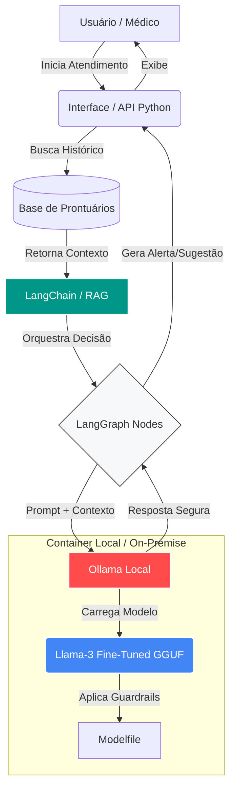

# Assistente Virtual Médico & Orquestrador Clínico IA

Projeto desenvolvido para o Tech Challenge da Fase 3 da FIAP. O sistema implementa um assistente virtual médico de alta precisão, treinado com dados e protocolos internos de um hospital (simulado), orquestrado por um pipeline de decisão automatizado e seguro.

A arquitetura do projeto foi desenhada para garantir a privacidade dos dados hospitalares (On-Premise/Local Execution), eliminando a dependência de APIs externas de IA durante a inferência. O projeto divide-se em duas bases principais:

- **Motor de IA (LLM Fine-Tuned):** Ajuste fino do LLaMA-3 (8B) focado em protocolos médicos e blindado por *guardrails* de segurança (treinado no Colab e exportado para execução local via GGUF).
- **Orquestração e Fluxos (LangChain/LangGraph):** Backend em Python para conectar o LLM a bases de dados estruturadas, gerenciar o histórico do paciente (RAG) e automatizar decisões lógicas.

## Requisitos

### Para a Execução Local (Inferência e Orquestração)

- Python 3.9 ou superior.
- [Ollama](https://ollama.com/) (para rodar o modelo GGUF localmente).
- Bibliotecas do `requirements.txt` (LangChain, LangGraph, etc).

---

## 1. Execução do Modelo de IA (Ollama)

O cérebro do assistente foi encapsulado em um arquivo `.gguf` quantizado para garantir alta performance em máquinas locais sem necessidade de GPUs dedicadas de grande porte.

O modelo fine-tuned não está incluído neste repositório devido ao tamanho dos arquivos. Baixe o GGUF pelo [Google Drive](https://drive.google.com/drive/folders/16AKzX3n8qjZYVpm3VQGJsxHdZBpKEDKC?usp=sharing) e coloque-o em `src/models/ModeloAssistenteMedico/`, junto ao `Modelfile`, antes de criar o modelo no Ollama. Arquivos `.gguf` são ignorados pelo Git.

### Subindo o modelo localmente

No terminal, navegue até a pasta onde o modelo e o `Modelfile` estão alocados:

```bash
cd src/models/ModeloAssistenteMedico/
```

Compile o modelo (este processo injeta as regras de segurança do hospital diretamente no sistema):

```bash
ollama create assistente_hospitalar -f Modelfile
```

Para interagir com o modelo puro via terminal e testar os *guardrails*:

```bash
ollama run assistente_hospitalar
```

---

## 2. Execução da Orquestração (LangChain / LangGraph)

Esta etapa ativa a conexão do assistente com os dados do paciente e executa os fluxos automatizados de atendimento.

### Instalação de dependências

Na raiz do projeto, crie um ambiente virtual e instale as dependências:

```bash
python -m venv venv
source venv/bin/activate  # No Windows: venv\Scripts\activate
pip install -r requirements.txt
```

### Inicialização do Sistema

```bash
# [COLEGA: Inserir o comando exato para rodar a aplicação Python/Interface]
python src/langchain_app/main.py
```

---

## 3. Fases do Desenvolvimento

### Fase 1: Preparação e Anonimização de Dados

Para garantir a LGPD e o sigilo médico, foi construído um pipeline de extração e limpeza (`src/data_preparation`). Usando Expressões Regulares (Regex), removemos dados sensíveis (PII) de laudos e formulários reais, criando um dataset sintético de instrução clínica.

### Fase 2: Fine-Tuning do LLM

Realizado no Google Colab (GPU T4) utilizando `Unsloth` para contornar limitações de hardware (BFloat16) e otimizar o tempo de treinamento. Aplicamos QLoRA nas matrizes de atenção do `Llama-3-8B-Instruct`. O resultado foi mesclado e quantizado em 8-bits (`Q8_0.gguf`).

### Fase 3: Integração LangChain e RAG

> [COLEGA: Preencher detalhando como o LangChain se conecta ao Ollama local e como é feita a consulta a prontuários usando a arquitetura RAG (Retrieval-Augmented Generation)].

### Fase 4: Automação com LangGraph

> [COLEGA: Preencher detalhando os fluxos de decisão automatizados. Ex: Paciente entra -> Analisa sintomas -> Recupera histórico -> Gera alerta ou sugestão clínica].

---

## 4. Segurança e Validação (Guardrails)

A segurança em ambientes hospitalares é inegociável. Implementamos três camadas de proteção:

1. **Limites de Atuação (Modelfile):** Instrução `SYSTEM` hardcoded que impede o modelo de prescrever medicamentos ou fechar diagnósticos autônomos sem supervisão médica.
2. **Explainability:** [COLEGA: Explicar como o RAG obriga o modelo a citar de qual protocolo/documento a informação foi retirada].
3. **Logging/Auditoria:** [COLEGA: Explicar a estratégia de logging do LangChain para rastrear o raciocínio do modelo].

---

## 5. Estrutura de Diretórios

- `data/raw/`: Protocolos e dados não tratados.
- `data/processed/`: Datasets anonimizados em formato JSONL (usados no treinamento).
- `src/data_preparation/`: Scripts de higienização e regex.
- `src/models/ModeloAssistenteMedico/`: Contém o `Modelfile` e o arquivo `.gguf` pesado.
- `src/langchain_app/`: [COLEGA: Scripts de integração do LangChain, LangGraph e APIs].

## 6. Arquitetura do Sistema



---

## Integrantes

* Cristofer Gaier Sais (rm374802)

* Luciano Gomes Pereira Júnior (rm374898)
